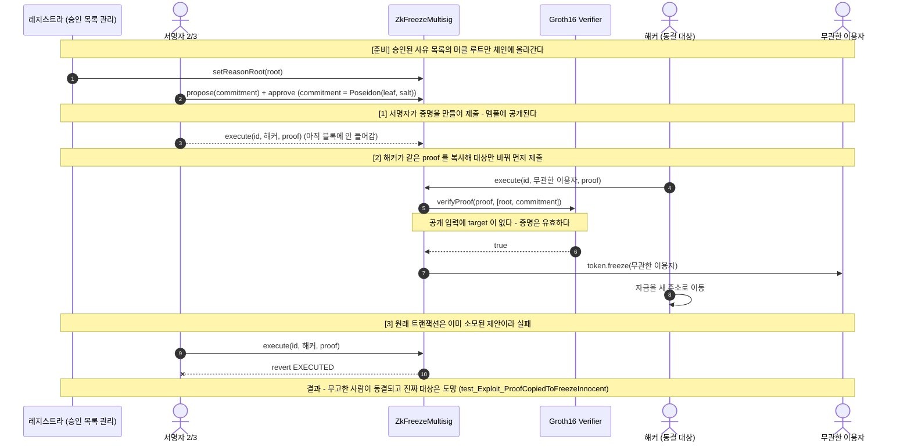
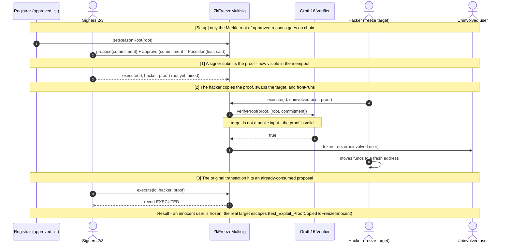

# 스테이블코인 동결 절차를 코드로 강제하기 — 커밋-리빌에서 영지식 증명까지


지난 글에서 USDT·USDC 컨트랙트를 읽으며 세 가지를 확인했습니다. 동결과 몰수가 함수 하나 차이로 나란히 있고, **동결 사유는 체인 어디에도 저장되지 않으며**, 멀티시그가 서명을 기다리는 동안 **대기 중인 동결 제안이 그대로 공개돼** 그 틈에 자금이 먼저 빠져나간다는 것이었습니다. 이 저장소는 그중 뒤의 두 가지를 **직접 고쳐보려는** 학습용 저장소입니다. 지난 저장소들처럼 **`순진하게 만든 버전` ↔ `고친 버전`** 을 쌍으로 두고, 깨지는 것과 막히는 것을 Foundry 테스트 11개로 확인했습니다. 사유 문제는 사유를 공개하지 않으면서 정당성을 보여야 해서, 처음으로 **Circom 회로와 Groth16 증명**을 직접 다뤘습니다.

> ⚠️ 이 저장소는 **동결 권한에 절차를 코드로 넣어보며 이해하려는 학습용**입니다. 실제 Tether·Circle 의 운영 절차를 분석하거나 특정 동결 조치의 정당성을 판단한 것이 아닙니다. trusted setup 은 로컬에서 혼자 기여한 것이라 안전하지 않으며, 어떤 코드도 프로덕션용이 아닙니다.

---

## 프로젝트 핵심 요소

1. **대기 중인 동결 제안이 새는 문제를 세 단계로 고치기 (01)**
   - 평문 제안 → `keccak256(target)` 로 가린 제안 → `keccak256(target, reasonHash, salt)` 커밋-리빌
   - 두 번째 버전은 "해시로 가렸으니 숨겨졌다" 고 생각했던 **내 첫 수정안**이다. 동결 대상은 자기 주소를 알기 때문에 해시를 한 번 계산하면 끝났다(`test_Exploit_UnsaltedHashIsGuessable`)
   - salt 를 넣은 커밋에서는 대상이 공개되는 순간과 동결되는 순간이 **같은 트랜잭션** 이 된다

2. **동결 사유를 공개하지 않고 증명하기 (02)**
   - 레지스트라(법원·감독기관 역할)가 **승인된 동결 사유 목록의 머클 루트** 만 올린다
   - 동결할 때는 "이 커밋은 그 목록에 있는 사유로 만들었다" 는 **Groth16 증명** 을 낸다. 사유 분류도 근거 문서도 체인에 올라가지 않는다
   - 목록에 없는 사유로는 **증명 자체가 만들어지지 않는다** (witness 생성 단계에서 `Assert Failed`, `scripts/make-fixtures.mjs`)

3. **ZK 를 붙였더니 새로 생긴 구멍과, 내 수정본의 한계까지 테스트로 남기기**
   - 처음 만든 회로는 커밋에 **동결 대상 주소가 없었다**. 증명을 본 누구든 대상만 바꿔 먼저 제출하면, 엉뚱한 사람이 동결되고 진짜 대상은 도망간다(`test_Exploit_ProofCopiedToFreezeInnocent`)
   - 고친 버전은 target 을 **공개 입력** 으로 묶었다. 그런데도 레지스트라가 목록을 갱신하면 진행 중이던 정당한 동결이 멈춘다(`test_Limit_RootUpdateInvalidatesPendingProof`)

---

## 시스템 아키텍처 & 라이프사이클 흐름

가장 배울 게 많았던 **02. ZK 증명이 "누구를" 에 묶여 있지 않을 때** 의 흐름입니다. 증명은 수학적으로 완벽하게 통과합니다. 문제는 증명이 말하는 **문장** 에 동결 대상이 들어 있지 않았다는 것입니다.



**한 줄 요약:** 영지식 증명은 **증명하기로 한 문장만** 증명한다. 문장에 "누구를" 이 빠져 있으면 증명이 아무리 정확해도 대상은 바꿔치기된다. 수정은 회로의 커밋을 `Poseidon(target, leaf, salt)` 로 바꾸고 `target` 을 공개 입력으로 올린 것이다.

---

## 단계별 & 확인한 것

| # | 지난 글의 질문 | 구현 파일 | 깨지는 것을 보인 테스트 | 어긋난 지점 |
|---|---|---|---|---|
| 01 | 대기 시간이 왜 신호가 되는가 | `01-pending-leak/` | `test_Exploit_TargetReadsPendingProposalAndEscapes` | 제안이 **평문으로 저장**됨 |
| 01 | (내 첫 수정안) | `FreezeMultisigHashed.sol` | `test_Exploit_UnsaltedHashIsGuessable` | 입력이 **추측 가능한** 해시 |
| 02 | 동결 사유는 어디에 저장되는가 | `02-zk-reason/` | `test_Exploit_ProofCopiedToFreezeInnocent` | 증명이 **대상에 묶이지 않음** |

### 01 — 대기 시간은 지울 수 없지만, 무엇을 기다리는지는 가릴 수 있다
멀티시그는 서명이 다 모일 때까지 기다려야 한다. 이건 안전장치라 없앨 수 없다. 문제는 **무엇을** 기다리는지가 공개된다는 점이었다. `proposals(id)` 를 읽은 해커는 마지막 서명 전에 자금을 옮기고, 동결은 설계대로 정확히 실행되지만 빈 주소를 묶는다.

처음엔 `keccak256(target)` 만 올리면 된다고 생각했다. 그런데 해시는 입력을 숨기는 도구가 아니라 **입력을 고정하는** 도구였다. 해커는 자기 주소를 알고 있으니 해시를 한 번 계산해 비교하면 된다. 숨기려면 추측할 수 없는 값(salt)이 함께 들어가야 했다. salt 를 넣은 커밋에서는 대상이 `execute` 안에서 처음 공개되고 같은 트랜잭션에서 동결되므로, 공개와 집행 사이에 틈이 없다.

### 01 → 02 — 고쳤더니 다른 질문이 그대로 남았다
`test_Limit_RevealedReasonIsUncheckable` 은 커밋-리빌 수정본의 한계다. 실행할 때 공개하는 `reasonHash` 는 그냥 32바이트라, 서명자 둘이 합의하면 `"no reason at all"` 로도 동결된다. 지난 글에서 "동결의 이유는 체인 어디에도 저장되지 않는다" 고 썼는데, 해시로 저장해도 **그게 정당한 사유인지는 여전히 아무도 모른다.** 사유를 공개하면 피해자·수사 정보가 드러나고, 공개하지 않으면 확인할 수 없다. 이 둘을 동시에 만족하려고 ZK 를 쓰게 됐다.

### 02 — 영지식 증명은 "증명하기로 한 문장" 만 증명한다
회로가 증명하는 문장은 이렇다.

> "나는 `(category, docHash)` 를 알고 있고, 그 사유는 `root` 아래의 승인 목록에 있으며, 서명자들이 승인한 `commitment` 는 이 사유와 `salt` 로 만든 것이다."

처음 만든 회로(`freeze_reason_unbound.circom`)에는 이 문장에 **동결 대상이 없었다.** 그래서 증명은 "어떤 사유가 승인됐다" 까지만 말하고, 그 사유로 **누구를** 동결하는지는 `execute` 의 인자가 정했다. 증명은 누구나 제출할 수 있게 열어뒀기 때문에, 멤풀에서 증명을 본 해커가 대상만 무관한 사람으로 바꿔 먼저 넣으면 그대로 통과했다. 지난 저장소의 cross-function 재진입과 같은 모양이었다 — 검사는 있었는데, **검사가 덮는 범위** 가 공격 대상보다 좁았다.

고친 회로(`freeze_reason.circom`)는 커밋을 `Poseidon(target, leaf, salt)` 로 바꾸고 `target` 을 공개 입력으로 올렸다. 컨트랙트는 `execute` 로 받은 주소를 그대로 공개 입력 자리에 넣어 검증하므로, 주소를 바꾸면 증명이 깨진다(`test_Fix_ProofIsBoundToTarget`). 그리고 01-fixed 에서는 가능했던 "사유 없는 동결" 이, 여기서는 서명자 둘이 합의해도 불가능하다(`test_Fix_NoRegisteredReasonNoFreeze`).

동결이 끝나면 대상 주소 옆에 `(commitment, root)` 를 남긴다. 체인만 봐도 "이 동결은 그 시점 승인 목록의 사유로 이뤄졌다" 는 것은 누구나 확인할 수 있고, 사유 원문은 이의제기가 들어왔을 때 서명자가 `(leaf, salt)` 를 열어 보이면 된다. 이게 지난 글의 두 번째 질문에 대한 지금의 내 답이다.

### 그리고 — 내 수정본도 완전하지 않다
- **레지스트라가 목록을 바꾸면 진행 중인 동결이 멈춘다.** 증명은 특정 `root` 에 대해 만들어지므로, 사유 하나만 추가돼도 이미 만든 증명이 전부 무효가 된다(`test_Limit_RootUpdateInvalidatesPendingProof`). Tornado Cash 가 최근 root 여러 개를 기억하는 이유를 여기서 이해했다. 아직 구현하지는 않았다.
- **증명은 "목록에 있다" 까지만 말한다.** 목록에 무엇을 넣는지는 여전히 레지스트라에 대한 신뢰다. 신뢰를 없앤 게 아니라, 서명자에서 레지스트라로 **옮긴** 것에 가깝다. K-Gold 에서 오라클을 다루며 했던 말을 다시 하게 됐다.
- **무고한 이용자에게 통지·이의제기 기간이 없다.** 동결은 여전히 즉시 집행된다. 지난 글에서 "유예 기간은 무고한 이용자에게도 빠져나가려는 쪽에게도 똑같이 주어진다" 고 했던 균형 문제는 이 저장소에서 풀지 못했다.
- **사유 하나로 몇 개의 주소든 동결할 수 있다.** 사유별 사용 횟수를 제한하려면 nullifier 가 필요해 보인다.
- **비용.** Groth16 검증 한 번에 약 **20만 가스** (`verifyProof` 195,613 ~ 202,220). 커밋-리빌 `execute` (약 8만 가스) 보다 3배 이상 비싸다. 동결이 자주 일어나는 일은 아니라 감당할 수 있다고 보지만, 판단은 보류했다.

---

## 기술 스택

| 구분 | 사용 기술 |
|---|---|
| **언어 / 컴파일러** | Solidity `0.8.25` (`foundry.toml` 에 고정), Circom `2.2.3` (`circom2` npm 패키지 — WASM 빌드) |
| **증명 시스템** | Groth16 over BN254, snarkjs `0.7.6` (trusted setup · 증명 생성 · Solidity verifier 생성) |
| **회로 라이브러리** | circomlib (Poseidon 해시), circomlibjs (JS 쪽 Poseidon 머클 트리) |
| **개발 · 테스트 프레임워크** | Foundry `1.8.1` (forge test, cheatcodes: `vm.prank`, `vm.expectRevert`, `vm.readFile`) |
| **테스트 라이브러리** | forge-std `v1.17.0` (`stdJson` 으로 증명 fixture 로드) |
| **환경** | macOS (Apple Silicon), Node.js 24 |
| **참고 자료** | 지난 글에서 읽은 USDT(`destroyBlackFunds`, `AddedBlackList`) · USDC(`blacklist`) 컨트랙트, BitOK 동결 회피 분석 |

---

## 트러블슈팅 및 환경 최적화

> **fixture 의 동결 대상과 테스트의 `hacker` 주소가 달랐다**
> - **문제 상황:** 증명은 snarkjs 가 만들고 테스트는 Foundry 가 돌린다. 증명의 공개 입력 `target` 을 Foundry 의 `makeAddr("hacker")` 와 맞추려고 `keccak256("hacker")` 의 뒤 20바이트를 넣었는데, 테스트 첫 줄의 단언이 `165936...032 != 949036...822` 로 실패했다.
> - **원인 분석:** `makeAddr(name)` 은 `keccak256(name)` 을 **개인키** 로 써서 주소를 만든다(`vm.addr(uint256(keccak256(name)))`). 해시 자체가 주소가 아니라, 그 키의 공개키에서 다시 주소를 뽑는다.
> - **해결 방안:** 빌드 스크립트에서 `cast wallet address --private-key $(cast keccak hacker)` 로 같은 방식으로 계산했다. 그리고 fixture 를 쓰는 모든 테스트가 **처음에 target 이 hacker 와 같은지부터 단언** 하도록 남겨두었다. 이 단언이 없었다면 엉뚱한 주소의 증명으로 테스트가 "통과" 했을 수도 있다.

> **snarkjs 가 만든 verifier 두 개의 이름이 겹쳤다**
> - **문제 상황:** 회로 두 개(순진한 버전 · 고친 버전)의 verifier 를 뽑았더니 둘 다 `contract Groth16Verifier` 라 한 테스트 파일에서 import 할 수 없었다.
> - **원인 분석:** `snarkjs zkey export solidityverifier` 는 컨트랙트 이름을 고정으로 출력한다.
> - **해결 방안:** 생성 직후 `sed` 로 이름만 `ReasonVerifier`, `UnboundReasonVerifier` 로 바꾸도록 `scripts/build.sh` 에 넣었다. 생성 파일을 손으로 고치지 않아서, 다시 빌드해도 같은 결과가 나온다.

> **Solidity 에 넣을 때 증명의 B 좌표 순서가 반대**
> - **문제 상황:** snarkjs JSON 의 `pi_b` 를 그대로 넣으면 검증이 실패한다.
> - **원인 분석:** G2 점의 좌표는 확장체 원소 `(x0, x1)` 인데, snarkjs JSON 과 이더리움 pairing 프리컴파일(EIP-197)이 받는 순서가 반대다.
> - **해결 방안:** fixture 를 만들 때 `[[b[0][1], b[0][0]], [b[1][1], b[1][0]]]` 로 바꿔 저장했다(`scripts/make-fixtures.mjs` 의 `toSol`).

> **`circom` 바이너리 없이 컴파일하기**
> - **문제 상황:** circom 공식 설치는 Rust 툴체인(`cargo`) 이 필요한데 개발 환경에 없었다.
> - **해결 방안:** circom 을 WASM 으로 빌드한 `circom2` npm 패키지를 devDependency 로 넣었다. `npm install` 만으로 컴파일러 · snarkjs · circomlib 가 모두 맞는 버전으로 설치된다.

---

## 실행 가이드 (Quick Start)

### 사전 조건 (Prerequisites)
- [Foundry](https://book.getfoundry.sh/) (`forge` 1.8.x)
- Node.js 18 이상 (회로를 다시 빌드할 때만 필요)

### 1) 저장소 받기 & 테스트 (증명 fixture 가 커밋돼 있어 Node 없이도 된다)
```bash
git clone https://github.com/Andrewpark-hub/stablecoin-freeze-zk-lab.git
cd stablecoin-freeze-zk-lab
forge test -vv        # 11개 전부 통과
```

### 2) 회로부터 다시 빌드하기 (trusted setup → verifier → 증명 생성, 약 40초)
```bash
npm install
./scripts/build.sh
forge test -vv
```

### 3) 단계 하나만 따라가며 보기
```bash
forge test --match-path test/01_PendingLeak.t.sol -vvv   # 대기 중인 제안 노출 → 커밋-리빌
forge test --match-path test/02_ZkReason.t.sol -vvv      # ZK 사유 증명 → target 바인딩
```

---

## 저장소 구조

```
circuits/
  lib/merkle.circom                 Poseidon 머클 포함 증명 (깊이 4 = 사유 16개)
  freeze_reason_unbound.circom  <-> freeze_reason.circom
  *.vkey.json                       검증 키
src/
  00-token/         FreezableStable.sol         (USDC blacklist 최소 모형)
  01-pending-leak/  FreezeMultisig.sol         <-> FreezeMultisigFixed.sol
                    FreezeMultisigHashed.sol    (salt 없는 해시 — 내 첫 수정안)
  02-zk-reason/     ZkFreezeMultisig.sol       <-> ZkFreezeMultisigFixed.sol
                    verifiers/                  (snarkjs 가 생성한 Groth16 verifier 2개)
test/
  01_PendingLeak.t.sol   02_ZkReason.t.sol
  fixtures/              snarkjs 로 미리 만든 증명 (JSON)
scripts/
  build.sh               컴파일 → trusted setup → verifier → fixture
  make-fixtures.mjs      승인 사유 머클 트리 · 증명 생성 · 목록 밖 사유 거부 확인
docs/
  freeze-questions-mapping.md   지난 글의 세 질문 → 이 저장소의 구현/미구현 + 남은 질문
```

---

## 배운 것 & 다음

- 지난 글의 결론은 "절차는 코드 바깥에만 있고, 코드 안에는 권한만 있다" 였다. 이번에 절차 두 개(대상 비공개, 사유 증명)를 코드 안으로 옮겨 보니, **절차를 넣을 때마다 그 절차를 누가 제출하고 무엇에 묶이는지** 라는 새 질문이 생겼다. 02 의 구멍은 ZK 를 몰라서가 아니라, 증명이 덮는 범위를 정하지 않아서 생겼다.
- 해시는 입력을 숨기지 않는다. 커밋이 무언가를 숨기려면 추측할 수 없는 값이 함께 들어가야 한다 — 이건 회로 안의 Poseidon 커밋에도 똑같이 적용돼서 `salt` 를 비공개 입력으로 넣었다.
- 지난 저장소의 세 질문 중 **어디에 저장하느냐** 가 이번에도 핵심이었다. 사유를 평문으로 저장하면 프라이버시가, 저장하지 않으면 검증이 깨진다. **봉인해서 저장하고, 필요할 때 열어 보인다** 가 지금의 답이다.
- 다음으로는 root 히스토리(최근 N개 root 허용)와 사유별 nullifier 를 넣어 위의 한계 두 개를 고쳐볼 계획이다. 무고한 이용자의 통지·이의제기 기간은 논문에서 다루려는 균형 문제라 따로 정리하려 한다.

---

*이 저장소의 취약 코드는 학습 목적의 의도된 결함을 포함합니다. 어떤 코드도 프로덕션에 사용하지 마세요. trusted setup 은 단일 기여자의 로컬 세리머니라 안전하지 않습니다. 또한 이 저장소는 법률·규제 자문이 아닙니다.*

---
---

# Enforcing Stablecoin Freeze Procedures in Code — From Commit-Reveal to Zero-Knowledge Proofs

*English version — the Korean original is above.*


In my previous post I read the USDT and USDC contracts and found three things: freezing and confiscation sit one function apart; **the reason for a freeze is stored nowhere on chain**; and while a multisig waits for signatures, **the pending freeze proposal is public**, so funds leave before the last signature lands. This learning repository tries to **actually fix** the last two. As in my earlier repositories, each step is a pair of **`a naive version` ↔ `a fixed version`**, and 11 Foundry tests confirm both the break and the fix. Proving a reason is legitimate without revealing it required zero-knowledge, so this is also my first hands-on work with **Circom circuits and Groth16 proofs**.

> ⚠️ This repository is **a learning exercise in putting procedure around freeze authority in code**. It does not analyze Tether's or Circle's real operating procedures, nor judge any specific freeze. The trusted setup is a single-contributor local ceremony and is not secure. None of this code is meant for production.

---

## Key Components

1. **Fixing the pending-proposal leak in three steps (01)**
   - Plaintext proposal → proposal hidden as `keccak256(target)` → commit-reveal with `keccak256(target, reasonHash, salt)`
   - The middle version was **my own first fix** — "it's hashed, so it's hidden." But the target knows its own address and only needs to hash it once (`test_Exploit_UnsaltedHashIsGuessable`)
   - With a salted commitment, the moment the target is revealed and the moment it is frozen become **the same transaction**

2. **Proving the freeze reason without revealing it (02)**
   - A registrar (playing the role of a court or supervisor) publishes only **the Merkle root of approved freeze reasons**
   - A freeze must carry a **Groth16 proof** that "this commitment was built from a reason in that list." Neither the category nor the supporting document goes on chain
   - With a reason that is not in the list, **a proof cannot even be generated** (`Assert Failed` at witness generation, `scripts/make-fixtures.mjs`)

3. **Recording the new hole ZK introduced, and the limits of my fix, as tests**
   - My first circuit **did not include the target address** in the commitment. Anyone who saw the proof could resubmit it first with a different target: an innocent address gets frozen and the real target escapes (`test_Exploit_ProofCopiedToFreezeInnocent`)
   - The fix binds the target as a **public input**. Even so, when the registrar updates the list, legitimate in-flight freezes stall (`test_Limit_RootUpdateInvalidatesPendingProof`)

---

## System Architecture & Lifecycle Flow

The case I learned the most from: **02, when the ZK proof is not bound to "whom."** The proof verifies perfectly. The problem is that the **statement** it proves never mentions the target.



**In one line:** a zero-knowledge proof proves **only the statement you chose to prove**. If "whom" is missing from the statement, the target can be swapped no matter how sound the proof is. The fix changes the circuit's commitment to `Poseidon(target, leaf, salt)` and makes `target` a public input.

---

## The Steps & What I Found

| # | Question from the previous post | Files | Test showing it breaks | Where it slipped |
|---|---|---|---|---|
| 01 | Why does the waiting period become a signal? | `01-pending-leak/` | `test_Exploit_TargetReadsPendingProposalAndEscapes` | proposal **stored in plaintext** |
| 01 | (my first fix) | `FreezeMultisigHashed.sol` | `test_Exploit_UnsaltedHashIsGuessable` | hash over a **guessable input** |
| 02 | Where is the freeze reason stored? | `02-zk-reason/` | `test_Exploit_ProofCopiedToFreezeInnocent` | proof **not bound to the target** |

### 01 — You can't remove the wait, but you can hide what is being waited on
A multisig has to wait for signatures; that is the safety mechanism and it stays. The problem was that **what** it waits on is public. A hacker who reads `proposals(id)` moves funds before the last signature, and the freeze then executes exactly as designed — on an empty address.

I first thought posting `keccak256(target)` would be enough. But a hash does not hide its input; it **pins** it. The hacker knows their own address and only has to hash it once. To hide anything, the commitment needs a value nobody can guess (a salt). With the salted commitment, the target is first revealed inside `execute` and frozen in the same transaction, leaving no gap between disclosure and enforcement.

### 01 → 02 — The fix left the other question standing
`test_Limit_RevealedReasonIsUncheckable` is the limit of the commit-reveal fix. The `reasonHash` revealed at execution is just 32 bytes, so if two signers agree, `"no reason at all"` freezes an address just fine. Last time I wrote that the reason for a freeze is stored nowhere on chain; storing it as a hash still means **nobody knows whether it is a legitimate reason**. Publishing it exposes victim and investigation details; not publishing it makes it unverifiable. Satisfying both at once is why I reached for ZK.

### 02 — A zero-knowledge proof proves only the statement you chose
The circuit proves this statement:

> "I know `(category, docHash)`; that reason is in the approved list under `root`; and the `commitment` the signers approved was built from this reason and a `salt`."

My first circuit (`freeze_reason_unbound.circom`) **had no target in that statement.** The proof said only "some approved reason exists," and **whom** to freeze was decided by the `execute` argument. Since I let anyone submit proofs, a hacker who saw the proof in the mempool could swap in an uninvolved address and get it through first. It was the same shape as the cross-function reentrancy in my earlier repository: the check existed, but **what the check covered** was narrower than what the attacker controlled.

The fixed circuit (`freeze_reason.circom`) changes the commitment to `Poseidon(target, leaf, salt)` and makes `target` a public input. The contract plugs the address it received in `execute` straight into that slot, so swapping the address breaks the proof (`test_Fix_ProofIsBoundToTarget`). And a "freeze with no reason," which 01-fixed allowed, is now impossible even when two signers agree (`test_Fix_NoRegisteredReasonNoFreeze`).

After a freeze, `(commitment, root)` is stored next to the target address. Anyone can confirm from the chain alone that "this freeze was made under a reason in the approved list at that time," and if the freeze is challenged, the signers can open `(leaf, salt)`. That is my current answer to the second question from the previous post.

### And — my fix is not complete either
- **A registrar update stalls in-flight freezes.** Proofs are made against a specific `root`, so adding a single reason invalidates every proof already prepared (`test_Limit_RootUpdateInvalidatesPendingProof`). This is where I understood why Tornado Cash remembers several recent roots. Not implemented yet.
- **The proof only says "it's in the list."** What goes into the list still depends on trusting the registrar. Trust was not removed; it **moved** from the signers to the registrar — the same thing I ended up saying about oracles in K-Gold.
- **Innocent users get no notice or challenge period.** Freezes still take effect immediately. The balance problem from the previous post — a grace period is given equally to innocent users and to those trying to escape — is not solved here.
- **One reason can freeze any number of addresses.** Limiting uses per reason looks like it needs a nullifier.
- **Cost.** One Groth16 verification costs about **200k gas** (`verifyProof` 195,613 – 202,220), more than 3x a commit-reveal `execute` (~80k). Freezes are rare, so it seems affordable, but I am holding off on a verdict.

---

## Tech Stack

| Category | Technology |
|---|---|
| **Language / Compiler** | Solidity `0.8.25` (pinned in `foundry.toml`), Circom `2.2.3` (`circom2` npm package — WASM build) |
| **Proof System** | Groth16 over BN254, snarkjs `0.7.6` (trusted setup, proving, Solidity verifier export) |
| **Circuit Libraries** | circomlib (Poseidon hash), circomlibjs (Poseidon Merkle tree in JS) |
| **Dev & Test Framework** | Foundry `1.8.1` (forge test, cheatcodes: `vm.prank`, `vm.expectRevert`, `vm.readFile`) |
| **Test Library** | forge-std `v1.17.0` (`stdJson` to load proof fixtures) |
| **Environment** | macOS (Apple Silicon), Node.js 24 |
| **Source Material** | USDT (`destroyBlackFunds`, `AddedBlackList`) and USDC (`blacklist`) contracts read in the previous post; BitOK's analysis of freeze evasion |

---

## Troubleshooting & Environment Notes

> **The fixture's freeze target did not match the test's `hacker` address**
> - **Problem:** proofs are generated by snarkjs and tests run in Foundry. To match the proof's public input `target` with Foundry's `makeAddr("hacker")`, I used the last 20 bytes of `keccak256("hacker")` — and the first assertion in the test failed with `165936...032 != 949036...822`.
> - **Root cause:** `makeAddr(name)` uses `keccak256(name)` as a **private key** (`vm.addr(uint256(keccak256(name)))`). The hash is not the address; the address is derived from that key's public key.
> - **Fix:** the build script now computes it the same way with `cast wallet address --private-key $(cast keccak hacker)`. Every test that uses the fixture **first asserts that the target equals `hacker`**. Without that assertion, a test could have "passed" with a proof for the wrong address.

> **The two snarkjs verifiers had the same name**
> - **Problem:** both exported verifiers were named `contract Groth16Verifier`, so one test file could not import both.
> - **Root cause:** `snarkjs zkey export solidityverifier` always emits that fixed name.
> - **Fix:** `scripts/build.sh` renames them with `sed` right after generation (`ReasonVerifier`, `UnboundReasonVerifier`). The generated files are never hand-edited, so rebuilding gives the same result.

> **The proof's B coordinates are in reverse order for Solidity**
> - **Problem:** passing `pi_b` from the snarkjs JSON as is makes verification fail.
> - **Root cause:** G2 coordinates are extension-field elements `(x0, x1)`, and the snarkjs JSON and Ethereum's pairing precompile (EIP-197) expect them in opposite orders.
> - **Fix:** fixtures are saved as `[[b[0][1], b[0][0]], [b[1][1], b[1][0]]]` (`toSol` in `scripts/make-fixtures.mjs`).

> **Compiling without the `circom` binary**
> - **Problem:** the official circom install needs a Rust toolchain (`cargo`), which this machine did not have.
> - **Fix:** added the `circom2` npm package (circom compiled to WASM) as a devDependency. `npm install` alone installs a matching compiler, snarkjs and circomlib.

---

## Quick Start

### Prerequisites
- [Foundry](https://book.getfoundry.sh/) (`forge` 1.8.x)
- Node.js 18+ (only to rebuild circuits)

### 1) Clone & test (proof fixtures are committed, so no Node needed)
```bash
git clone https://github.com/Andrewpark-hub/stablecoin-freeze-zk-lab.git
cd stablecoin-freeze-zk-lab
forge test -vv        # all 11 pass
```

### 2) Rebuild from the circuits (trusted setup → verifier → proofs, ~40s)
```bash
npm install
./scripts/build.sh
forge test -vv
```

### 3) Follow a single step
```bash
forge test --match-path test/01_PendingLeak.t.sol -vvv   # pending-proposal leak → commit-reveal
forge test --match-path test/02_ZkReason.t.sol -vvv      # ZK reason proof → target binding
```

---

## Repository Structure

```
circuits/
  lib/merkle.circom                 Poseidon Merkle inclusion (depth 4 = 16 reasons)
  freeze_reason_unbound.circom  <-> freeze_reason.circom
  *.vkey.json                       verification keys
src/
  00-token/         FreezableStable.sol         (minimal model of USDC's blacklist)
  01-pending-leak/  FreezeMultisig.sol         <-> FreezeMultisigFixed.sol
                    FreezeMultisigHashed.sol    (unsalted hash — my first fix)
  02-zk-reason/     ZkFreezeMultisig.sol       <-> ZkFreezeMultisigFixed.sol
                    verifiers/                  (two Groth16 verifiers generated by snarkjs)
test/
  01_PendingLeak.t.sol   02_ZkReason.t.sol
  fixtures/              proofs pre-generated with snarkjs (JSON)
scripts/
  build.sh               compile → trusted setup → verifier → fixtures
  make-fixtures.mjs      approved-reason Merkle tree, proving, rejection of unlisted reasons
docs/
  freeze-questions-mapping.md   the previous post's three questions → built / not built here, open questions
```

---

## What I Learned & What's Next

- My previous post concluded that "procedure lives only outside the code; inside the code there is only authority." Moving two procedures (hiding the target, proving the reason) into the code raised a new question each time: **who submits this procedure, and what is it bound to?** The hole in 02 did not come from not knowing ZK; it came from not deciding what the proof should cover.
- A hash does not hide its input. A commitment only hides something if it includes a value no one can guess — the same applies to the Poseidon commitment inside the circuit, which is why `salt` is a private input.
- Of the three questions from my SEC repository, **where you store it** was again the core. Store the reason in plaintext and privacy breaks; don't store it and verification breaks. **Store it sealed, and open it when needed** is my answer for now.
- Next I plan to fix two of the limits above with a root history (accepting the last N roots) and per-reason nullifiers. The notice and challenge period for innocent users is the balance problem my paper is about, so I will write that up separately.

---

*The vulnerable code in this repository contains intentional flaws for educational purposes. Do not use any of it in production. The trusted setup is a single-contributor local ceremony and is not secure. This repository is also not legal or regulatory advice.*
